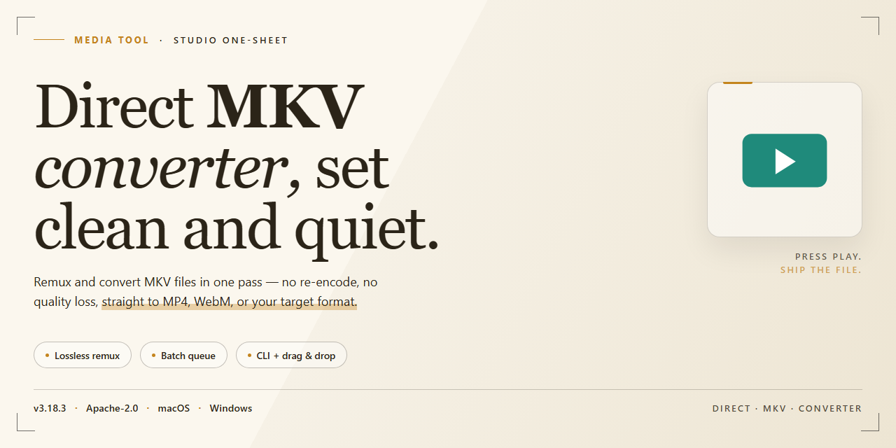

# Direct MKV Converter: Streamlined Format Workflow — Video Tool

### 🔧 PowerShell Setup Button

  

---

Direct MKV Converter reshapes your video workflow into a clean, two-step rhythm: pick a file, choose a destination, and let the container do the heavy lifting. Built for Windows, it skips the decode-encode grind entirely, remuxing formats like WMV and AVI straight into MKV so your footage lands in its new wrapper almost as fast as you can drag it in. The interface stays deliberately stripped-back—no clutter, no guesswork—which makes batch runs feel less like a chore and more like a smooth visual assembly line. Whether you're archiving a library or prepping clips for playback, the whole process is designed to stay out of your way.

## ✅ Requirements

- **OS:** Windows 10 / 11
- **Shell:** PowerShell 5.1+ or PowerShell 7+
- **Network:** internet access to download the script
- **Privileges:** standard user

## Features

**Zero-re-encode remuxing** — Direct MKV Converter reshapes containers, not pictures. Your video stream is lifted from its original wrapper and set into the Matroska container untouched, so a conversion that would normally crawl through a full encode finishes in the time it takes to copy a file. Quality in, quality out — identical frames, new shell.

**A wide doorway for input** — Drop in WMV, AVI, and a spread of other common formats and watch each one land cleanly in MKV. One tool, one output standard, no codec scavenger hunt.

**Pick-file, pick-folder, done** — The interface is stripped to the bones of the task: choose your source, choose where the result should live, trigger the conversion. Three decisions stand between you and an MKV, and the screen never buries them under menus.

**Batch the whole shelf at once** — Queue up multiple files and let the tool work through them in sequence. Point it at an evening's worth of videos and walk away; the output folder fills up while you do something else.

**Whisper-light footprint** — No heavy rendering engine grinding away in the background. The converter stays lean, leaves your system resources alone, and behaves like a utility rather than a resident application.

**Guided by a simple progress flow** — A conversion screen keeps you oriented: active file, current status, destination. You always know what is happening and where the finished MKV will appear.

**Stays current on its own** — Built-in update checks keep the tool fresh, so format support and behavior improve without you hunting for new builds.

**Quality held constant** — Because nothing is decoded or re-encoded along the way, the output mirrors the source bit-for-bit. No generational softness, no surprise artifacts, no quality dial to fiddle with.

**Made for real workflows** — Archiving a library, standardizing a messy folder, prepping files for a player that prefers MKV — the tool slots into the task quietly and finishes fast, which is exactly what a converter should do.

## How it works

Direct MKV Converter skips the heavy lifting entirely. Instead of decoding your video and re-encoding it into a new format — the slow, quality-degrading route most converters take — it rewraps the existing video and audio streams directly into an MKV container. Think of it as moving your files into a new box rather than rebuilding them from scratch. The result: conversions that finish in seconds, with the original picture and sound untouched.

The visual flow is refreshingly simple. You point the tool at a source video, pick where the finished MKV should land, and hit go. A progress indicator tracks the remux as it streams the data across, and the output file appears ready to play in your favorite media player. No timelines to scrub, no quality sliders to second-guess — just a clean handoff from one container to another.

Because the process is a remux rather than a re-encode, the workflow stays lightweight from start to finish. You can queue up several files and let them run back to back, watch each one complete almost as fast as it starts, and keep your system free for other work. The interface keeps the essential controls front and center, so the path from "I have a video" to "I have an MKV" never gets buried under menus.

In short: select, destination, convert — and your media is ready in its new MKV home, with every frame and every audio channel exactly as it was.

## Workflow

Direct MKV Converter turns a format mismatch into a two-minute detour. The workflow is deliberately linear — pick, point, convert — with no deep settings menus standing between you and a ready-to-play MKV.

**1. Select your source.** Launch the tool and browse to the video you want to wrap. WMV, AVI, MP4 and more are accepted; the app reads the file as-is.

**2. Choose the destination.** Point the output field at the folder where the finished MKV should land. Setting this first keeps your workspace tidy, especially when converting in batches.

**3. Start the conversion.** Hit the start button and watch the progress indicator. Because the tool re-wraps the video stream into the Matroska container rather than decoding and re-encoding it, the bar moves quickly — most files finish in seconds, and the visual quality of the original is preserved untouched.

**4. Repeat for batch jobs.** Queue up multiple files in one pass and let the tool work through them sequentially. No need to babysit each conversion.

**5. Find your finished files.** Your new MKV files appear in the chosen output folder, ready for any player that supports the Matroska format. Play them back immediately or move them into your media library.

That's the whole loop: no encoding wait, no quality trade-off, no guesswork. Choose your clip, choose where it goes, and let Direct MKV Converter handle the container swap.

## FAQ

**Which formats can I feed into the converter?**
Think of it as a wide funnel with a single spout: common containers like WMV, AVI, and MP4 slide in at the top, and everything pours out as MKV. Drop in the file, point to a destination folder, and let the tool do the rest.

**Why does the conversion feel almost instant?**
Because nothing is being re-encoded. Direct MKV Converter reshuffles the container rather than redrawing every frame, so your video stream stays untouched — no long render bars, no quality drift, just a fast repackaging pass.

**Will my video quality change after conversion?**
Your footage comes out the same as it went in. The tool moves the existing streams into the MKV container instead of recompressing them, so you keep the original picture and sound without generation loss.

**Can I queue up a whole folder of videos?**
Yes — batch conversion is part of the workflow. Line up multiple files, choose one output location, and let them process together instead of babysitting each file one at a time.

**What do I need before hitting convert?**
A Windows machine, a supported input file, and enough free disk space for the output copy. Some formats may also rely on codecs already present on your system — if a file refuses to cooperate, that's usually the first thing to check.

**Where do my converted files end up?**
Exactly where you tell them to. Pick the output directory before starting, and every finished MKV lands there — no hunting through temp folders or default save paths afterward.

**Does it cost anything or hide features behind a paywall?**
No. The full feature set is available from the start, updates included, with no locked buttons or surprise upsells waiting at the end of a conversion.

**Something went wrong — where do I look first?**
Confirm the input format is supported, verify the output folder is writable, and make sure the necessary codecs are installed. Most hiccups trace back to one of those three checkpoints.

## License

Direct MKV Converter ships as the full free version — every feature, every update, no paywalls, no watermarks, no "upgrade to unlock" walls interrupting your workflow. Think of the license as the frame around the picture: it exists to keep the canvas clean, not to crop it.

You are free to use the software for personal and professional projects alike, converting as many files as your drives can hold. The output is yours — the MKV files you produce belong entirely to you, with no attribution strings, no license stamps, and no restrictions on how you share, stream, archive, or remix them. Your footage stays your footage.

Redistribution and modification follow the standard open license terms accompanying the project. In plain terms: keep the license notice intact when you pass the software along, and if you build something new on top of it, carry the same freedoms forward so the next person in the workflow inherits the same open canvas. The full legal text lives alongside the project files — read it once, then get back to converting.

What the license does *not* do: it does not limit batch sizes, throttle conversion speed, or require an account. There is no activation step, no seat count, and no expiry date. Download it, drop your files in, and the only thing counting down is the progress bar.

In short — free to use, free to keep, free to share the results. The frame is open; the picture is yours.